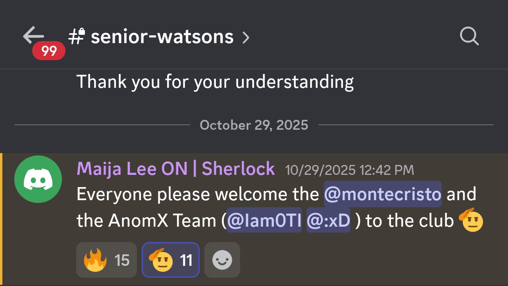

# Iam0ti

Independent security researcher interested in blockchain, smart contracts, program analysis, zero-knowledge systems, cryptography, software correctness, and low-level systems.

## Work

Multiple top 1, top 5, and top 10 finishes in security contests.

- 50+ vulnerabilities identified, including 15+ High, Medium, or Low severity findings.

- Audit collaboration profile: [AnomX](https://audits.sherlock.xyz/watson/anomx)
- Sherlock researcher: [Iam0ti](https://audits.sherlock.xyz/watson/iam0ti)
- Became a Senior Watson on Sherlock on October 29, 2025.
- HackenProof researcher: [baldIguana](https://hackenproof.com/hackers/baldIguana)

  
- [3rd place — HackenProof × BlockZ contest](https://x.com/HackenProof/status/1979143500848415028?s=20)

> I deleted my hackenproof account for some weird reason , so my contest history is no longer available on the platform.

## Areas

Solidity · Vyper · Clarity · EVM · Move/Sui 

## Links

- [GitHub](https://github.com/iam0TI)
- [About](https://iam0ti.github.io/about/)
- - Email: [iam0ti@proton.me](mailto:iam0ti@proton.me)
